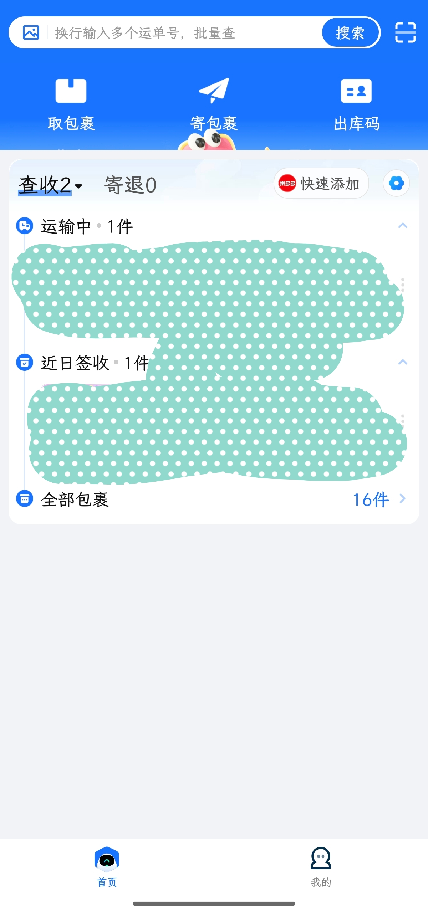
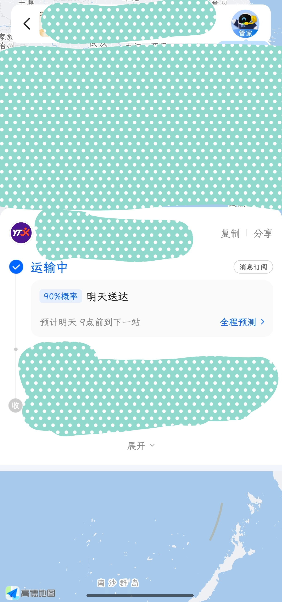
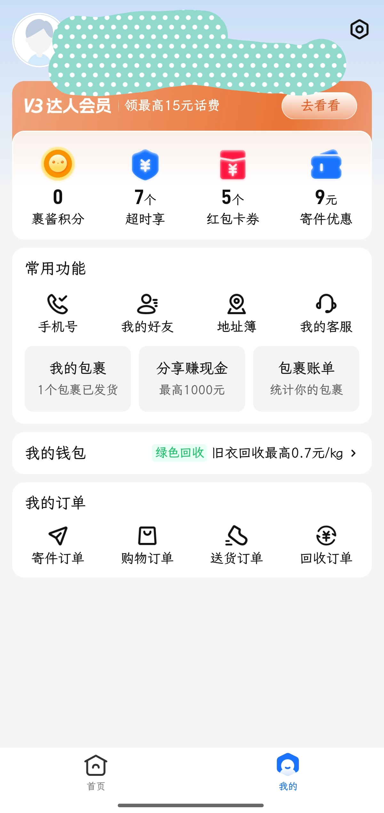

# FuckCainiao

菜鸟界面优化和广告移除

## Fork 说明

本仓库 fork 自 [duzhaokun123/FuckCainiao](https://github.com/duzhaokun123/FuckCainiao)，与上游的主要差异：

- **包名/应用 ID** 改为 `io.github.lisrain.fuckcainiao`，可与上游版本共存安装
- **libxposed API 101**（`minApiVersion=101` / `targetApiVersion=101`），不使用 API 102 专属的热重载能力，兼容范围聚焦 101+ 框架
- 适配菜鸟 **8.11.727**：底栏 tab 隐藏（含登录后重建时重新隐藏）、导航栏颜色同步、物流详情广告清理等 hooks 调整
- **彻底阻断应用更新**：更新检查请求不再发出、安装包不再下载、残留升级包自动清理，「更新安装包已经下载好」弹窗不再出现
- 「我的」页 H5 推广清理：四条注入路径覆盖 WebView 复用、重定向与首次登录场景
- 首页移除“物换物”入口（金刚栏 / DinamicX 缓存渲染双重过滤）
- 拦截“关于 FuckCainiao”入口的跳转，点击不弹原作者的捐赠提示

## 下载

https://github.com/lisrain/FuckCainiao_Fork/releases

## 效果

> 截图中的个人信息与运单数据已打码。

|  |  |  |
|:---:|:---:|:---:|
| **首页** 底栏只留「首页 / 我的」，金刚栏移除「物换物」，推荐流清空不再插入信息流广告 | **查件页** 物流详情页的活动推广、会员福利横幅移除，只保留轨迹与地图 | **我的** 「热门活动」卡片与底部轮播推广移除，「我的订单」之后不再插入推荐流 |

## Thanks

### 工具

[jadx](https://github.com/skylot/jadx)

开发者助手专业版(`cn.trinea.android.developertools.pro`)

### 库

[AOSP](https://source.android.com/)

[libxposed](https://github.com/libxposed/api)
